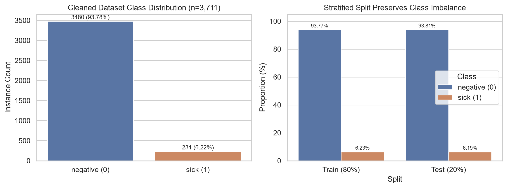
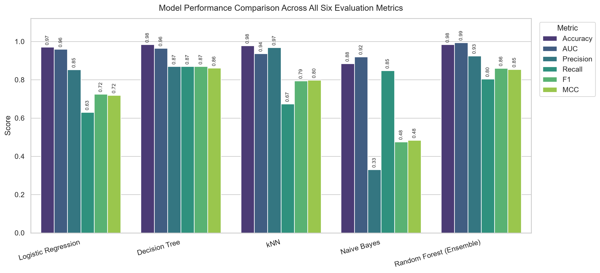
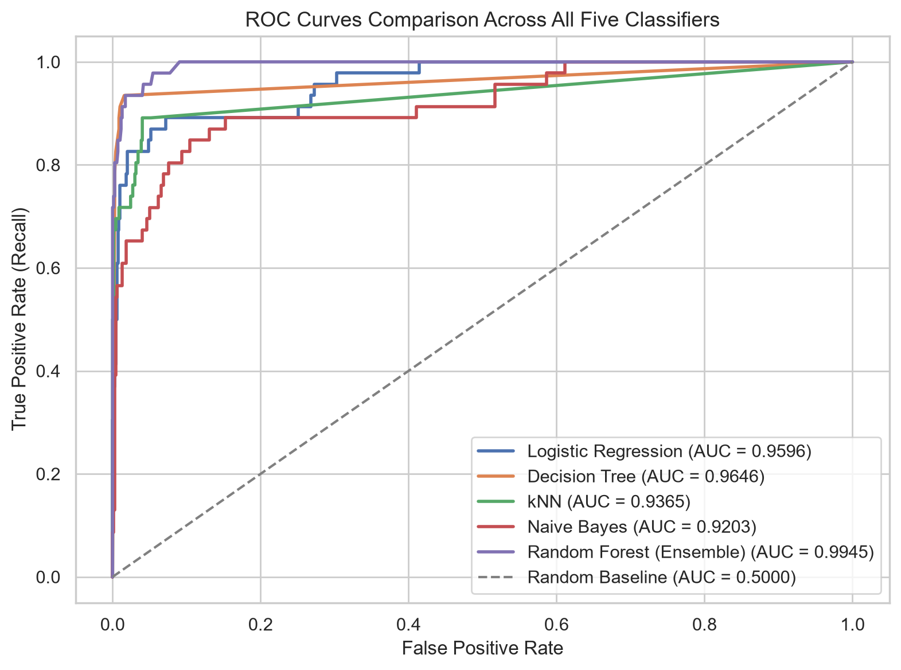
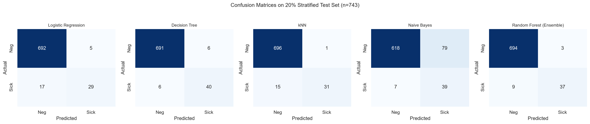

# Euthyroid Sick Syndrome Classification Using Supervised Machine Learning

## 1. Problem Statement

Clinical thyroid screening produces a combination of demographic attributes, patient history flags, and continuous hormone assay measurements (such as `TSH`, `T3`, `TT4`, `T4U`, and `FTI`). Identifying **euthyroid sick syndrome (`sick`)** from routine screening records is a challenging binary classification problem because abnormal hormone readings often co-occur across overlapping endocrine conditions, clinical tests frequently have missing values when specific assays are not ordered, and positive `sick` diagnoses represent a small minority (~6.2%) of all patient visits.

The objective of this assignment is to build a leak-free, reproducible machine learning pipeline that preprocesses real clinical screening data and systematically compares five classification algorithms—**Logistic Regression**, **Decision Tree**, **K-Nearest Neighbors (kNN)**, **Gaussian Naive Bayes**, and **Random Forest (Ensemble)**—across six evaluation metrics: **Accuracy**, **AUC**, **Precision**, **Recall**, **F1 Score**, and **Matthews Correlation Coefficient (MCC)**.

---

## 2. Dataset Description

- **Source:** [UCI Machine Learning Repository — Thyroid Disease (`sick` dataset, Garavan Institute)](https://archive.ics.uci.edu/dataset/102/thyroid+disease) (mirrored on OpenML as `data_id=38`).
- **Why This Dataset Was Selected:**
  1. Meets and exceeds all assignment size criteria (**3,772 raw instances**, **3,711 unique instances** after deduplication; **29 input attributes**, **27 active input features** after removing the all-null `TBG` and constant `TBG_measured` columns).
  2. Presents genuine real-world data quality challenges: missing values across both numeric lab assays and categorical columns, an impossible age entry (`455.0`), exact duplicate records (`61`), mixed numeric/categorical features, and strong class imbalance.
  3. High clinical relevance where minority-class metrics (**Recall**, **F1**, **AUC**, and **MCC**) are much more informative than raw Accuracy alone.

### Target Variable & Class Imbalance Examination

- **Target Variable:** `Class` (`negative` mapped to `0`, `sick` mapped to `1`).
- **Class Distribution (after removing 61 exact duplicates, total $n = 3,711$):**
  - `negative` (`0`): **3,480** instances (**93.78%**)
  - `sick` (`1`): **231** instances (**6.22%**)
  - **Imbalance Ratio:** ~15.06 : 1 (`negative` : `sick`). Because a trivial majority-class predictor already achieves 93.78% accuracy, balanced metrics such as **F1**, **AUC**, and **MCC** are essential for model comparison.



### Feature Types

After dropping `TBG` (3,772/3,772 missing, i.e., 100% null) and `TBG_measured` (constant `'f'` across all instances), **27 input features** remain:
- **6 Numerical Features (`float64`):** `age`, `TSH`, `T3`, `TT4`, `T4U`, `FTI`.
- **21 Categorical / Binary Features:**
  - Nominal multi-category (`5` levels): `referral_source` (`SVHC`, `other`, `SVI`, `STMW`, `SVHD`).
  - Binary clinical / lab-measurement flags (`2` levels each): `sex` (`F`/`M`), `on_thyroxine`, `query_on_thyroxine`, `on_antithyroid_medication`, `sick` (patient symptom flag), `pregnant`, `thyroid_surgery`, `I131_treatment`, `query_hypothyroid`, `query_hyperthyroid`, `lithium`, `goitre`, `tumor`, `hypopituitary`, `psych`, `TSH_measured`, `T3_measured`, `TT4_measured`, `T4U_measured`, `FTI_measured`.

### Data Preprocessing & Leak-Free Split Strategy

1. **Missing Values Identified & Handled:**
   - Raw missing counts: `TBG` (3,772), `T3` (769), `T4U` (387), `FTI` (385), `TSH` (369), `TT4` (231), `sex` (150), `age` (1).
   - `TBG` and constant `TBG_measured` were dropped.
   - `1` physiologically impossible `age` entry (`455.0`) was replaced with `NaN` for imputation.
   - Remaining missing numerical values are imputed with **training-set median** (`SimpleImputer(strategy="median")`); missing categorical values are imputed with **training-set mode** (`SimpleImputer(strategy="most_frequent")`).
2. **Duplicate Removal:** **61 exact duplicate rows** were removed prior to splitting (`3,772 -> 3,711`) to prevent identical patient records from leaking across train and test sets.
3. **Train-Test Split:** **80:20 stratified split** (`random_state=42`, `stratify=y`):
   - **Training set:** 2,968 rows (`negative`: 2,783, `sick`: 185).
   - **Test set (`test_data.csv`):** 743 rows (`negative`: 697, `sick`: 46).
4. **Categorical Encoding & Conditional Feature Scaling:**
   - Categorical columns are encoded using `OneHotEncoder(handle_unknown="ignore", drop="if_binary", sparse_output=False)`.
   - `StandardScaler()` is applied to numerical features **only for models sensitive to feature scale** (**Logistic Regression**, **kNN**, and **Gaussian Naive Bayes**), and omitted for scale-invariant tree models (**Decision Tree** and **Random Forest**).
   - Every imputer, encoder, and scaler is wrapped inside a `scikit-learn` `Pipeline` (`ColumnTransformer`) and **fitted strictly on `X_train`** (`fit(X_train, y_train)`), then applied to `X_test`.

---

## 3. GitHub Repository Link

- **Repository URL:** [https://github.com/2026ct05026/bits-ml-assignment-2.git](https://github.com/2026ct05026/bits-ml-assignment-2.git)

### Repository Structure

```text
bits-ml-classification-assignment/
|-- main.py                          # End-to-end training, evaluation, and plotting entry point
|-- requirements.txt                 # Python dependencies
|-- README.md                        # Assignment documentation and results
|-- test_data.csv                    # Held-out 20% stratified test dataset
|-- data/
|   |-- thyroid_sick_raw.csv         # Cached UCI Thyroid ('sick') dataset
|-- model/
|   |-- __init__.py
|   |-- config.py                    # Paths, random seed (42), feature schemas
|   |-- preprocessing.py             # Cleaning, deduplication, stratified split, ColumnTransformer
|   |-- evaluation.py                # Metrics (Accuracy, AUC, Precision, Recall, F1, MCC) & plots
|   |-- logistic_regression.py       # Logistic Regression module
|   |-- decision_tree.py             # Decision Tree Classifier module
|   |-- knn.py                       # K-Nearest Neighbors module
|   |-- naive_bayes.py               # Gaussian Naive Bayes module
|   |-- random_forest.py             # Random Forest Ensemble module
|   |-- logistic_regression_model.joblib
|   |-- decision_tree_model.joblib
|   |-- knn_model.joblib
|   |-- naive_bayes_model.joblib
|   |-- random_forest_model.joblib
|-- results/
    |-- metrics_comparison.csv
    |-- class_distribution.png
    |-- metrics_comparison.png
    |-- roc_curves.png
    |-- confusion_matrices.png
```

### Execution Instructions

```bash
# 1. Install dependencies
pip install -r requirements.txt

# 2. Run the full preprocessing, training, evaluation, and visualization pipeline
python main.py

# 3. (Optional) Run an individual model module standalone
python -m model.random_forest
```

---

## 4. Models Used & Evaluation Results

### Model Configurations

| ML Model Name | Configuration (`random_state=42`) | Feature Scaling |
|---|---|---|
| Logistic Regression | `LogisticRegression(C=1.0, max_iter=1000, random_state=42)` | Yes (`StandardScaler`) |
| Decision Tree | `DecisionTreeClassifier(criterion="gini", max_depth=8, min_samples_leaf=5, random_state=42)` | No |
| kNN | `KNeighborsClassifier(n_neighbors=5, weights="distance", metric="minkowski", p=2)` | Yes (`StandardScaler`) |
| Naive Bayes | `GaussianNB(var_smoothing=1e-1)` | Yes (`StandardScaler`) |
| Random Forest (Ensemble) | `RandomForestClassifier(n_estimators=200, random_state=42, n_jobs=1)` | No |

### Evaluation Metrics Comparison Table (20% Stratified Test Set, $n = 743$)

| ML Model Name | Accuracy | AUC | Precision | Recall | F1 | MCC |
|---|---:|---:|---:|---:|---:|---:|
| Logistic Regression | 0.9704 | 0.9596 | 0.8529 | 0.6304 | 0.7250 | 0.7188 |
| Decision Tree | 0.9838 | 0.9646 | 0.8696 | 0.8696 | 0.8696 | 0.8610 |
| kNN | 0.9785 | 0.9365 | 0.9688 | 0.6739 | 0.7949 | 0.7983 |
| Naive Bayes | 0.8843 | 0.9203 | 0.3305 | 0.8478 | 0.4756 | 0.4843 |
| Random Forest (Ensemble) | 0.9838 | 0.9945 | 0.9250 | 0.8043 | 0.8605 | 0.8543 |

### Graph Representation of Evaluation Metrics







### Observations on Model Performance

| ML Model Name | Observation about model performance |
|---|---|
| Logistic Regression | Achieves solid Accuracy (0.9704), AUC (0.9596), and Precision (0.8529), but its linear decision boundary misses several non-linear clinical threshold cases, resulting in the lowest Recall (0.6304) and moderate F1 (0.7250) and MCC (0.7188). |
| Decision Tree | Performs remarkably well (Accuracy 0.9838, F1 0.8696, MCC 0.8610, Recall 0.8696) because euthyroid sick diagnosis closely follows crisp axis-aligned lab assay cutoffs (e.g., `T3`, `TT4`, `FTI`). However, its leaf probability estimates produce a noticeably lower AUC (0.9646) than Random Forest. |
| kNN | Delivers the highest Precision (0.9688) among all models—producing almost no false positives—but suffers on Recall (0.6739) and AUC (0.9365) because distance-based neighborhoods in the 27-feature one-hot/scaled space are dominated by the 93.8% majority class. |
| Naive Bayes | Achieves high Recall (0.8478) and strong rank-ordering AUC (0.9203) when stabilized with `var_smoothing=1e-1`, yet yields the lowest Precision (0.3305), Accuracy (0.8843), F1 (0.4756), and MCC (0.4843) because its conditional independence assumption is violated by strongly correlated thyroid hormone biomarkers (`TT4`, `FTI`, `T3`, `T4U`). |
| Random Forest (Ensemble) | Achieves the **highest AUC (0.9945)** by a clear margin, ties for the **highest Accuracy (0.9838)**, and maintains very strong Precision (0.9250), F1 (0.8605), and MCC (0.8543). Averaging 200 trees dramatically smooths probability calibration and reduces variance compared to a single tree. |
| Overall Winner for your dataset? | **Random Forest (Ensemble)** is the overall winner for probability ranking and clinical decision support (**AUC = 0.9945**, **Accuracy = 0.9838**, **Precision = 0.9250**), while **Decision Tree** edges ahead slightly on default-threshold **F1 (0.8696)** and **MCC (0.8610)** due to higher Recall (0.8696 vs 0.8043). In clinical screening where threshold tuning can leverage Random Forest's near-perfect 0.9945 ROC-AUC, Random Forest offers the strongest generalization. |

---

## 5. BITS Virtual Lab Execution Screenshot- attached in the assignment pdf given.


